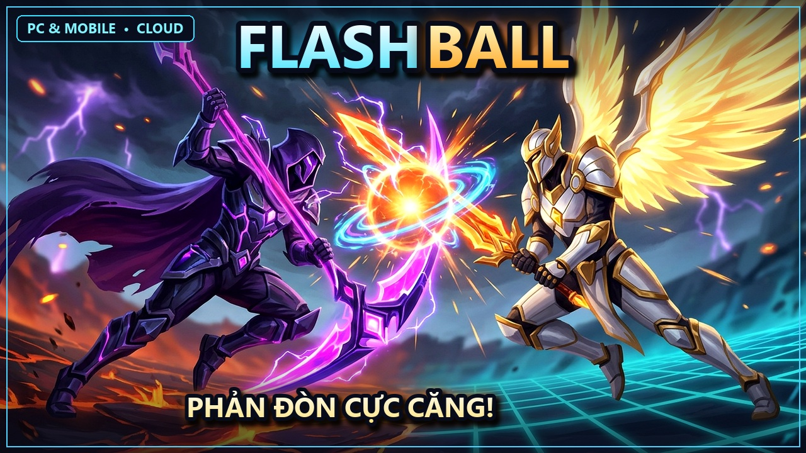
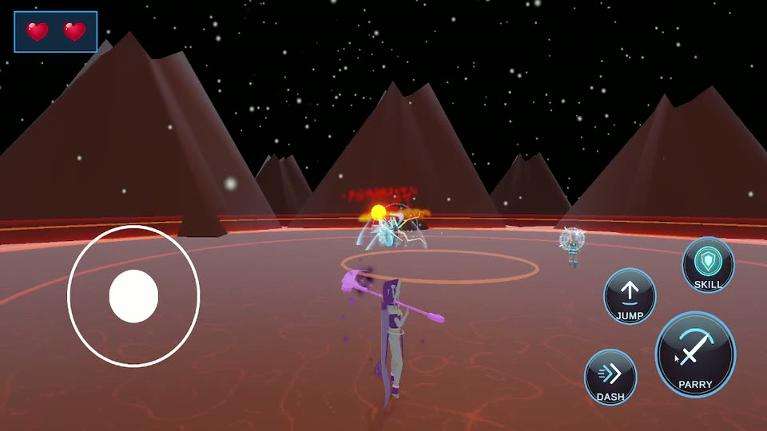
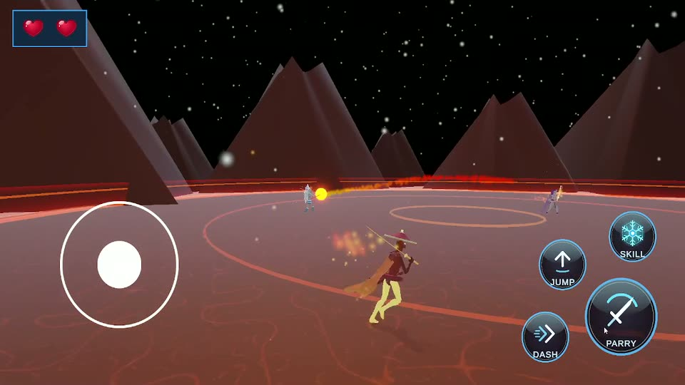
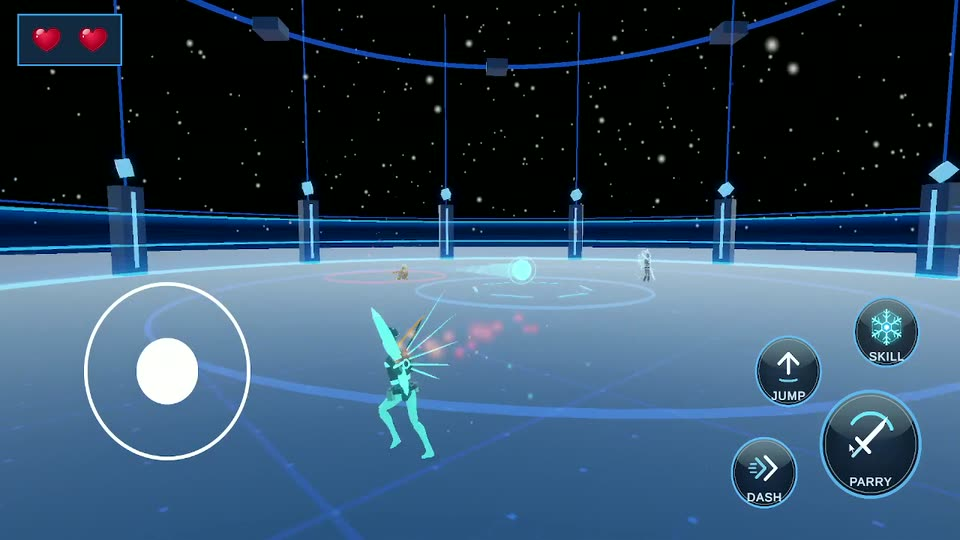
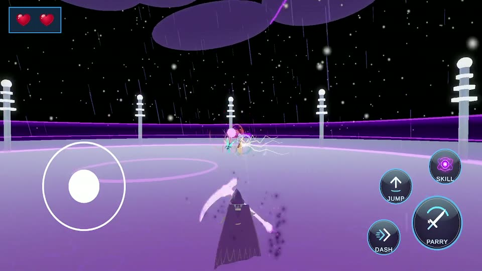
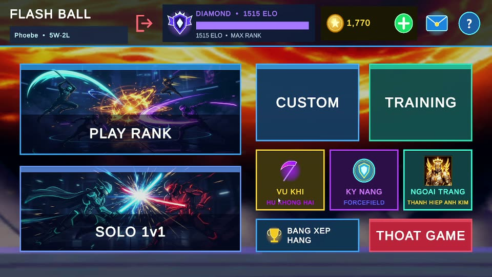
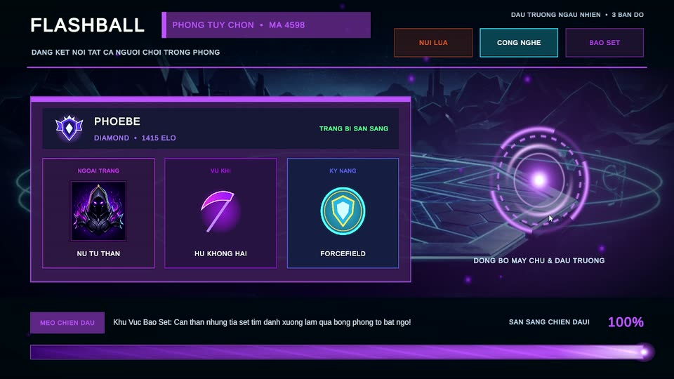
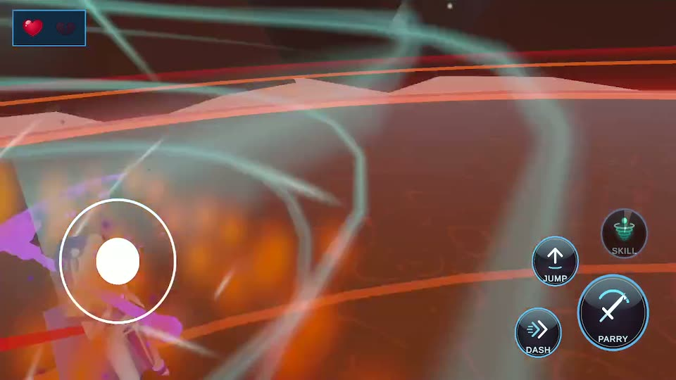
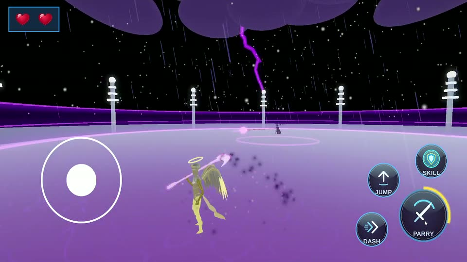
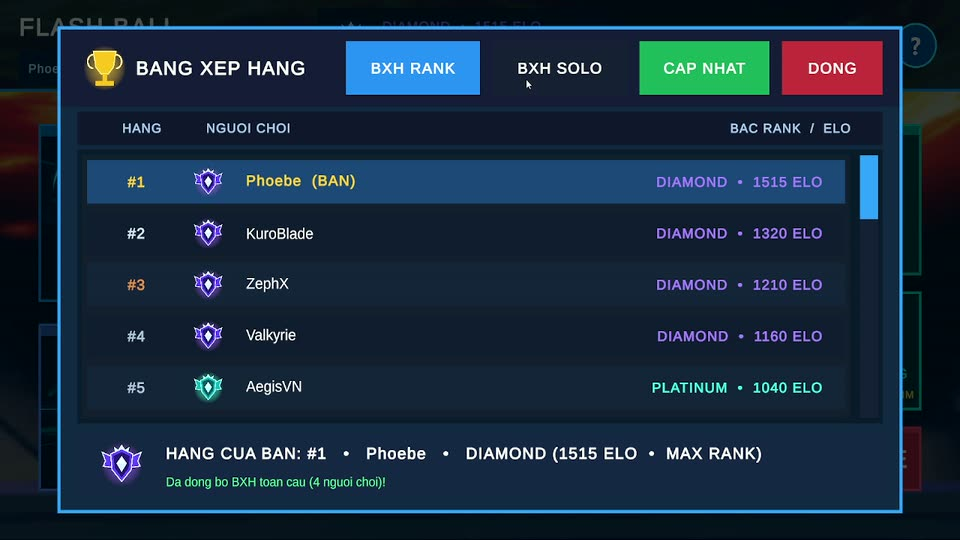

<div align="center">

# ⚡ FLASHBALL — Game Design Document (GDD)

**Tựa game đấu trường hành động phản đòn tốc độ cao trên PC & Mobile — Đồng bộ tài khoản & Bảng Xếp Hạng Cloud thời gian thực!**

[](https://youtu.be/NEt6Mgq7HRo?si=fI3Wd_uzxh0G01YE)


<br/>

[](https://youtu.be/NEt6Mgq7HRo?si=fI3Wd_uzxh0G01YE)

> 🎬 **Nhấn vào ảnh bìa trên để xem Video Gameplay Showcase chính thức trên YouTube:** [https://youtu.be/NEt6Mgq7HRo](https://youtu.be/NEt6Mgq7HRo?si=fI3Wd_uzxh0G01YE)

</div>

---

## 📋 Mục Lục
1. [Tổng Quan Trò Chơi (Game Overview)](#1-tổng-quan-trò-chơi-game-overview)
2. [Cơ Chế Chiến Đấu Cốt Lõi (Core Combat Mechanics)](#2-cơ-chế-chiến-đấu-cốt-lõi-core-combat-mechanics)
3. [Các Chế Độ Chơi (Game Modes)](#3-các-chế-độ-chơi-game-modes)
4. [Đấu Trường & Cơ Chế Bản Đồ (Arenas — Liên Tục Cập Nhật)](#4-đấu-trường--cơ-chế-bản-đồ-arenas--liên-tục-cập-nhật)
5. [Kho Vũ Khí Nguyên Tố, Kỹ Năng & Ngoại Trang](#5-kho-vũ-khí-nguyên-tố-kỹ-năng--ngoại-trang)
6. [Hệ Thống Xếp Hạng, Kinh Tế & Đồng Bộ Cloud](#6-hệ-thống-xếp-hạng-kinh-tế--đồng-bộ-cloud)
7. [Thiết Kế Âm Thanh (Audio Design)](#7-thiết-kế-âm-thanh-audio-design)
8. [Thư Viện Hình Ảnh Gameplay](#8-thư-viện-hình-ảnh-gameplay)
9. [Kiến Trúc Kỹ Thuật & Cấu Trúc Dự Án](#9-kiến-trúc-kỹ-thuật--cấu-trúc-dự-án)
10. [Hướng Dẫn Cài Đặt & Chạy Dự Án](#10-hướng-dẫn-cài-đặt--chạy-dự-án)

---

## 1. Tổng Quan Trò Chơi (Game Overview)

| Hạng mục | Mô tả |
| :--- | :--- |
| **Tên dự án** | **FLASHBALL** |
| **Thể loại** | 3D Action Arena / High-Speed Parry Combat (Lấy cảm hứng từ phong cách Blade Ball) |
| **Nền tảng** | PC (Windows) & Mobile (Android) — Hỗ trợ điều khiển cảm ứng + bàn phím/chuột |
| **Chế độ mạng** | Online Multiplayer (Photon Fusion — hỗ trợ Dedicated Server & AutoHost/Client) + Bot AI thông minh |
| **Lưu trữ dữ liệu** | Đồng bộ Cloud liên thiết bị qua Firebase Realtime Database (Singapore) |
| **Nội dung** | Đa dạng bản đồ, vũ khí nguyên tố, kỹ năng & ngoại trang — **liên tục cập nhật** |

### 🎯 Vòng Lặp Trải Nghiệm Cốt Lõi (Core Gameplay Loop)
```text
Đăng Nhập / Đăng Ký Cloud ──▶ Chọn Chế Độ (Rank / Solo 1v1 / Custom / Training)
        ▲                                              │
        │                                              ▼
Mở Khóa Vũ Khí, Kỹ Năng,                  Tìm Trận (FindMatch Radar UI)
Ngoại Trang & Leo BXH Cloud                            │
        ▲                                              ▼
        │                                 Chọn Kỹ Năng Trước Trận (10s)
        │                                              │
        └──────── Nhận ELO, Thăng Hạng & Vàng ◀── Giao Tranh Phản Đòn Tốc Độ Cao
```

---

## 2. Cơ Chế Chiến Đấu Cốt Lõi (Core Combat Mechanics)

Mỗi đấu thủ bắt đầu với **2 Tim (HP)** trong một đấu trường năng lượng khép kín có rào chắn 360° chống rơi khỏi map. Một **Quả Bóng Năng Lượng** sẽ tự động khóa mục tiêu (hiển thị bằng tia laser khóa đỏ nối từ bóng tới mục tiêu) và lao tới với tốc độ tăng dần sau mỗi nhịp phản đòn.

| Thao tác | Điều khiển | Cơ chế chi tiết |
| :--- | :--- | :--- |
| **Di chuyển** | Joystick ảo / `W A S D` | Di chuyển linh hoạt 360° theo hướng camera, có giới hạn biên đấu trường mượt mà. |
| **Parry (Phản đòn)** | Chạm nhanh nút `PARRY` | Đánh bật quả bóng sang đối thủ gần nhất, tăng tốc độ bóng và tích hợp **Parry Buffer (0.15s)** giúp nhạy tay ngay cả ở tốc độ cao. |
| **Power Parry (Tụ lực)** | Nhấn giữ `PARRY` rồi thả | Tụ hào quang nguyên tố dọc thân vũ khí; khi thả sẽ đánh bật bóng với lực cực đại, quỹ đạo cong hiểm hóc và hiệu ứng âm thanh nguyên tố uy lực. |
| **Dash (Lướt né)** | Nút `DASH` | Lướt nhanh né góc bóng hoặc áp sát đối thủ so kè cận chiến (hồi chiêu `1.5s`). |
| **Jump (Nhảy)** | Nút `JUMP` / `Space` | Nhảy linh hoạt hỗ trợ Coyote Time, có thể kết hợp vừa nhảy vừa Parry trên không. |
| **Skill (Kỹ năng)** | Nút `SKILL` | Kích hoạt kỹ năng chủ động đã trang bị để tạo đột biến hoặc lật kèo trong các pha cận chiến. |

<div align="center">
  
  <br/>
  <sub><i>Những pha so kè cận chiến mặt đối mặt với nhịp Parry tốc độ chóng mặt và tia lửa va chạm rực rỡ.</i></sub>
</div>

---

## 3. Các Chế Độ Chơi (Game Modes)

| Chế độ | Quy mô | Đặc điểm chính |
| :--- | :---: | :--- |
| 🏆 **PLAY RANK** | Nhiều người chơi | Đấu trường sinh tử tranh điểm **ELO** theo thứ hạng, tự động cộng/trừ ELO & kích hoạt **hoạt ảnh tiến hóa bậc Rank** khi thăng cấp. |
| ⚔️ **SOLO 1v1** | 1 vs 1 | Đối đầu tay đôi trực diện cực căng, ghi nhận thành tích **Thắng / Thua (W-L)** lên **BXH Solo Toàn Cầu**. |
| 🛠️ **CUSTOM** | Phòng mã riêng | Tạo phòng với mã số riêng mời bạn bè lập kèo, tùy chỉnh thêm Bot đối kháng linh hoạt. |
| 🎯 **TRAINING** | Luyện tập | Phòng tập riêng với Bot giúp tân thủ làm quen nhịp Parry, Dash, Nhảy né & thử nghiệm kỹ năng trước khi leo Rank. |

### Màn Hình Tìm Trận (FindMatch) & Loading Hiện Đại
- **FindMatch UI:** Thiết kế phong cách Cyber-Esports đổi màu theo chế độ chơi, tích hợp **Radar quét 2 vòng xoay**, chấm trạng thái số người đã kết nối phòng, đồng hồ số kèm thanh quét động, xem nhanh **Ngoại Trang • Vũ Khí • Kỹ Năng** đang mang và mẹo chiến đấu luân phiên.
- **Loading Scene:** Hiển thị thẻ trang bị sẵn sàng của người chơi, lõi quả cầu năng lượng FlashBall xoay động và danh sách bản đồ ngẫu nhiên.

---

## 4. Đấu Trường & Cơ Chế Bản Đồ (Arenas — Liên Tục Cập Nhật)

Mỗi trận đấu sẽ chọn ngẫu nhiên một đấu trường với kiến trúc, ánh sáng, hình thái quả bóng, rào chắn năng lượng và bản nhạc nền riêng biệt (sẽ tiếp tục bổ sung thêm nhiều bản đồ mới trong các bản cập nhật tới):

| 🌋 Đấu Trường Núi Lửa (`ClassicNight`) | 🌐 Đấu Trường Công Nghệ (`CyberTech`) | ⚡ Khu Vực Bão Sét (`ThunderStorm`) |
| :---: | :---: | :---: |
|  |  |  |
| **Cầu Lửa Dung Nham** rực cháy giữa dãy núi lửa & biển nham thạch phát sáng, tàn lửa bay rực rỡ. | **Bóng Plasma Cyan** với vòng Gyro xoay trong đấu trường thép **Blue-Black Neon** & hàng rào Hologram. | **Bóng Điện Tím** dưới mưa bão & cột thu lôi trắng — **Sét tím bất ngờ đánh xuống phóng to kích thước & tăng tốc quả bóng!** |

---

## 5. Kho Vũ Khí Nguyên Tố, Kỹ Năng & Ngoại Trang

> ✨ Kho trang bị trong **FlashBall** cực kỳ đa dạng và **liên tục được mở rộng, cập nhật thêm mẫu mới** qua từng phiên bản.

### 🗡️ Hệ Thống Vũ Khí Nguyên Tố (Mỗi loại có VFX chém & âm thanh Parry riêng!)

| Vũ khí | Nguyên tố | Hiệu ứng chém & Âm thanh Parry đặc trưng |
| :--- | :--- | :--- |
| **Phong Kiếm** *(Wind Blade)* | 🍃 Gió | Vệt chém lưỡi liềm gió xanh ngọc thanh thoát + âm thanh xé gió êm sắc gọn. |
| **Hỏa Đao** *(Flame Saber)* | 🔥 Lửa | Đại đao cong cháy rực lửa + tàn lửa bay lên + tiếng lửa bùng trầm ấm uy lực. |
| **Lôi Thương** *(Thunder Spear)* | ⚡ Sấm Sét | Trường thương mũi sét phóng tia điện zig-zag + tiếng plasma & sấm rền ấm tai. |
| **Băng Song Kiếm** *(Frost Dual Blades)* | ❄️ Băng | Song kiếm pha lê băng cầm 2 tay + mảnh tuyết vỡ + âm thanh chém đôi vang pha lê dịu. |
| **Hư Không Hái** *(Void Scythe)* | 🌌 Hư Không | Lưỡi hái khổng lồ tím-đen + hào quang ôm khít lưỡi + âm xoáy trọng lực trầm sâu. |

### 🌀 Kho Kỹ Năng Chủ Động (Active Skills)

| Kỹ năng | Cơ chế nổi bật |
| :--- | :--- |
| **Phân Thân Bóng (`CloneBall`)** | Tạo quả bóng giả bay song song đánh lạc hướng phản xạ đối thủ. |
| **Tàng Hình (`Invisible`)** | Hóa bóng ma ẩn thân, thoát khỏi khóa mục tiêu của bóng và tăng tốc độ chạy. |
| **Lốc Xoáy (`Tornado`)** | Cuốn quả bóng xoay cao theo cột phễu lốc xoáy rồi lao vút xuống tấn công đối thủ. |
| **Đóng Băng (`Freeze`)** | Bọc tinh thể băng làm chậm quả bóng bay êm về phía mình để dễ canh Parry chuẩn xác. |
| **Khiên Lực (`Forcefield`)** | Kích hoạt vòm năng lượng tự động phản đòn (**Auto-Parry**) khi bóng bay vào tầm. |
| **Tâm Linh (`Telekinesis`)** | Bắt đứng quả bóng trên không bằng vòng niệm lực rồi bắn ngược siêu tốc vào kẻ vừa đánh tới. |

### 🎭 Kho Ngoại Trang 3D (Skins)
Tùy biến nhân vật phong cách Cyber/Fantasy với phụ kiện, áo choàng, đôi cánh và hào quang đặc trưng: **Tân Binh (Starter)**, **Cyber Runner** (cánh năng lượng neon), **Huyết Ronin** (giáp samurai đỏ rực), **Chiến Thần Bão** (Storm Valkyrie), **Thánh Hiệp Ánh Kim** (đôi cánh thiên thần vàng rực), **Nữ Tử Thần** (áo choàng vải mềm huyền bí)... và nhiều mẫu mới liên tục cập nhật!

---

## 6. Hệ Thống Xếp Hạng, Kinh Tế & Đồng Bộ Cloud

- **Hệ thống Bậc Rank & Hoạt Ảnh Tiến Hóa:**
  `Bronze (Đồng)` ➔ `Silver (Bạc)` ➔ `Gold (Vàng)` ➔ `Platinum (Bạch Kim)` ➔ `Diamond (Kim Cương)`
  Khi đủ ELO vượt mốc, game kích hoạt màn hình **Lắp Ráp Tiến Hóa Bậc Rank** toàn màn hình với 4 mảnh năng lượng hợp nhất cực mãn nhãn.
- **Tài Khoản & Đồng Bộ Cloud Liên Thiết Bị:**
  - Hỗ trợ Đăng Ký / Đăng Nhập tài khoản trực tiếp, đổi nick, nút đóng `X` quay về Menu an toàn.
  - Toàn bộ **Vàng, ELO, Win/Loss, Vũ Khí, Kỹ Năng, Ngoại Trang đã mua** được đồng bộ tức thì lên **Firebase Realtime Database**, cho phép đăng nhập cùng một tài khoản chơi liền mạch giữa **PC và Điện thoại**.
- **Bảng Xếp Hạng Cloud Toàn Cầu (`BXH RANK` & `BXH SOLO`):** Có nút **`CẬP NHẬT`** đồng bộ thứ hạng thực tế thời gian thực.
- **Kinh Tế & Tân Thủ:**
  - Hoàn thành trận đầu tiên nhận **Thư Quà Tân Thủ** trong Hòm Thư (+500 Vàng & mở khóa miễn phí chiêu Đóng Băng).
  - Nhận vàng thưởng sau mỗi trận đấu hoặc xem quảng cáo thưởng (`+100 Vàng`).

---

## 7. Thiết Kế Âm Thanh (Audio Design)

Toàn bộ âm thanh được quản lý tự động qua `GameAudioManager` (hỗ trợ nút **Bật/Tắt Loa** trực tiếp trên thanh TopBar Menu):
- **4 bản nhạc nền lặp mượt (Seamless Loop + Crossfade):** Nhạc sảnh Menu riêng và 3 bản nhạc chiến đấu riêng cho từng đấu trường (**Núi Lửa • Công Nghệ • Bão Sét**), tự động hạ nhẹ âm lượng khi tải màn hoặc tổng kết trận.
- **Âm thanh Parry theo nguyên tố vũ khí:** Thay thế hoàn toàn tiếng kim loại chói tai bằng **10 bản âm thanh Parry riêng (Thường & Power)** cho 5 hệ nguyên tố, xử lý lọc ấm dưới ~5.5 kHz giúp nghe cực đã tai ngay cả khi so kè liên thanh tốc độ cao.
- **Âm thanh kỹ năng & UI:** Đầy đủ SFX riêng cho từng kỹ năng, Dash, Jump, Sét Tím, Trúng đòn, Hạ gục, Đếm ngược 3-2-1, Chiến Thắng / Thất Bại, Thăng Hạng và tự động gắn âm thanh Click / Confirm / Cancel cho mọi nút UI.

---

## 8. Thư Viện Hình Ảnh Gameplay

<table>
  <tr>
    <td align="center" width="50%">
      <br/>
      <sub><b>Sảnh Chính (Main Lobby)</b> — Rank, Vàng, Hòm Thư & Cửa Hàng</sub>
    </td>
    <td align="center" width="50%">
      <br/>
      <sub><b>Loading Scene Hiện Đại</b> — Thẻ trang bị & Lõi Plasma xoay động</sub>
    </td>
  </tr>
  <tr>
    <td align="center" width="50%">
      <br/>
      <sub><b>Kỹ Năng Lốc Xoáy (Tornado)</b> — Cuốn bóng xoáy cao kết liễu đối thủ</sub>
    </td>
    <td align="center" width="50%">
      <br/>
      <sub><b>Solo 1v1 Nảy Lửa</b> — Thánh Hiệp Ánh Kim giữa Khu Vực Bão Sét</sub>
    </td>
  </tr>
  <tr>
    <td align="center" colspan="2">
      <br/>
      <sub><b>Bảng Xếp Hạng Cloud Toàn Cầu</b> — Đồng bộ BXH Rank & BXH Solo theo thời gian thực</sub>
    </td>
  </tr>
</table>

---

## 9. Kiến Trúc Kỹ Thuật & Cấu Trúc Dự Án

- **Engine:** Unity `6000.0.54f1` (Universal Render Pipeline — URP)
- **Networking:** Photon Fusion (StateAuthority / InputAuthority, RPC đồng bộ VFX & âm thanh)
- **Backend / Cloud DB:** Firebase Realtime Database REST API (`AccountDatabaseService`, `LeaderboardManager`)
- **UI Framework:** Unity uGUI + TextMeshPro (Responsive Anchor Layout chuẩn PC 16:9 & Mobile màn hình tràn viền)

```text
Assets/
├── Resources/
│   ├── Audio/
│   │   ├── BGM/              # 4 nhạc nền lặp mượt (Menu, Volcano, Cyber, Storm)
│   │   └── SFX/              # 33 SFX (10 Parry nguyên tố, 7 Kỹ năng, Combat & UI)
│   ├── Skins/                # Tài nguyên ngoại trang 3D
│   ├── Weapons/              # Model 3D vũ khí nguyên tố
│   ├── UI/                   # Icon biểu tượng, nền thẻ & huy hiệu bậc Rank
│   └── CloudAuthConfig.json  # Cấu hình kết nối Firebase RTDB
├── Scenes/
│   ├── MenuScene.unity       # Sảnh chính, Shop, BXH, Custom, FindMatch
│   ├── LoadingScene.unity    # Màn hình tải trận động
│   └── GamePlayScene.unity   # Đấu trường chiến đấu
└── Scripts/
    ├── Core/                 # GameManager, ArenaMapManager, GameAudioManager, LoadingSceneManager
    ├── Combat/               # BallController, ParryChange, ParrySlashVFX, WeaponElementController
    ├── Player/               # PlayerMovement, PlayerAbilityController, PlayerHealth, PlayerSkinController, AutoParryBot
    ├── Network/              # MatchmakingManager, NetworkPlayer
    ├── Data/                 # AccountDatabaseService, PlayerStatsManager, LeaderboardManager, Catalogs
    └── UI/                   # MenuUI, MatchFlowUI, MatchResultUI, CustomLobbyUI, Shops, LeaderboardUI, OnboardingUI
```

---

## 10. Hướng Dẫn Cài Đặt & Chạy Dự Án

1. **Clone repository:**
   ```bash
   git clone https://github.com/anhduc071023-ctrl/FlashBall.git
   ```
2. **Mở bằng Unity Hub:** Sử dụng phiên bản **Unity `6000.0.54f1`** (hoặc Unity 6 tương đương).
3. **Cấu hình Photon App ID** trong `Assets/Photon/Fusion/Resources/PhotonAppSettings.asset` (nếu dùng ứng dụng Photon riêng).
4. **Mở `Assets/Scenes/MenuScene.unity` và nhấn `Play`:**
   - Chọn **Training** để chơi thử ngay với Bot.
   - Chọn **Rank / Solo / Custom** để ghép phòng online (tự động fallback Host + Bot khi chạy test trong Editor).
5. **Build Android / PC:** Mở `File -> Build Profiles`, đảm bảo thứ tự 3 Scene:
   - `0`: `MenuScene`
   - `1`: `LoadingScene`
   - `2`: `GamePlayScene`

---

<div align="center">
  <b>⚡ FLASHBALL — Phản Đòn Tốc Độ Cao • Đa Dạng & Liên Tục Cập Nhật! ⚡</b>
</div>
